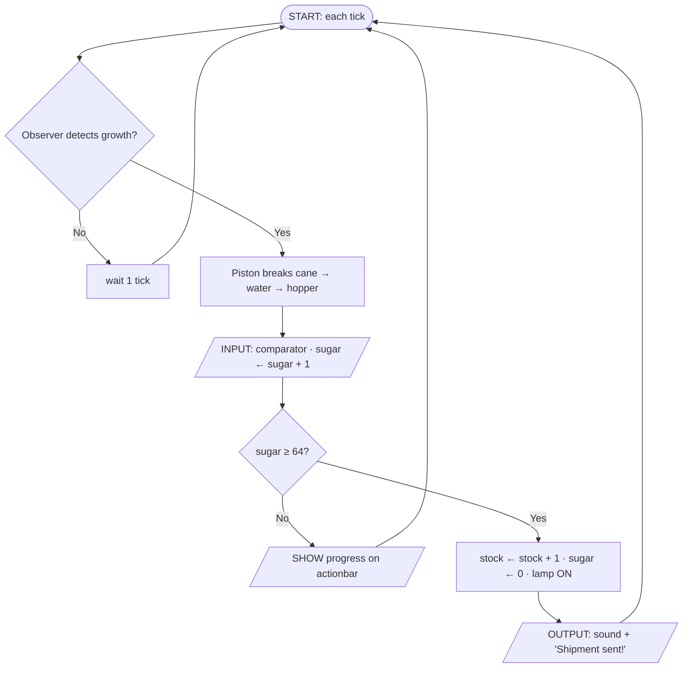

# 📑 Cluckwork Studios: Studio Planning Portfolio

**Project:** Cluckwork Valley · Theme A: Automated Factory & Smart Farm Complex
**Course:** Year 9 Computing Technology · Task #4 (30%) · Deliverable 2 (/10)
**Studio:** one whole-class studio of 12 · **Final version:** FINAL, 13 Nov 2026

> This is the text version of the portfolio. The website's **Portfolio** section shows the same content with the diagrams. For a PDF, print the website (Ctrl/Cmd + P → Save as PDF).

---

## 1. Problem statement & scope

**Audience:** players aged 10–15 and their teachers.

**Problem:** automated farms and factories produce most of what we eat, but the logic inside them (sensors, decisions, feedback loops) is invisible to the people who rely on them.

**Solution:** a see-through automated valley in Minecraft Education. Every machine has glass walls, an explanation sign and a status lamp, and a 10-minute game loop gives players a reason to interact with each system.

**In scope:** automated farms, a scoreboard economy, a teleport network, an elevator, an opt-in arena, an Agent replanting routine, and accessibility and ethics features.
**Out of scope:** survival combat, real-money mechanics, add-ons and mods, and anything that needs an internet connection.

## 2. Requirements

### Functional (what it does)

| ID | Requirement | Test | Result |
|---|---|---|---|
| F1 | Sugar cane is harvested automatically when it reaches height 3, with no player input. | Observed 3 game days; 0 stalks missed. | ✅ |
| F2 | The `sugar` score adds 1 per item and resets to 0 after each 64-item shipment. | Inserted 64, 65 and 128 items. | ✅ |
| F3 | Golem eyes turn on at night and off in the day. | `/time set 13000` then `/time set 1000`. | ✅ |
| F4 | All 9 teleport pads send the player to the right zone, facing the entrance, with a sound and a title. | Both directions on every pad. | ✅ |
| F5 | The elevator reaches floors 1–30 and is clamped at both ends. | Boundary tests at floors 1 and 30. | ✅ |
| F6 | The shop sells only if coins ≥ price AND stock ≥ 1, otherwise it shows an error. | Tested with 0, 9, 10 and 11 coins, and with 0 stock. | ✅ |
| F7 | The game has a start, a win (250 coins), a lose (timer = 0) and a full reset. | 5 full external playtests. | ✅ |
| F8 | The Agent replants a 9 × 9 field, skipping the resting strip and blocks already planted. | `replant` run 3× in a row. | ✅ |

### Non-functional (how well it performs)

| ID | Requirement | Test | Result |
|---|---|---|---|
| N1 | ≥ 50 FPS on school laptops. | FPS counter at 3 busy zones; lowest was 54. | ✅ |
| N2 | A new player starts a shift within 60 s of spawning, without help. | 4 Year 7 testers; average 38 s. | ✅ |
| N3 | Every game event gives text, sound and light feedback. | Played muted, then with the screen dimmed. | ✅ |
| N4 | Players cannot grief or break core systems. | "Try to break it" session. | ✅ |

## 3. System logic model: Sugar Mill → Market

### IPO chart

| Input | Process | Output |
|---|---|---|
| Observer detects cane at the 2nd block | Pulse fires piston, which breaks the stalk | Cane drops into the water stream |
| Hopper comparator signal ≥ 1 | `sugar ← sugar + 1` | Actionbar "Sugar: n / 64" |
| `sugar` score | IF sugar ≥ 64 THEN `stock + 1`, `sugar ← 0` ELSE keep counting | Level-up sound, "Shipment sent!", shop lamp ON |
| BUY button | IF coins ≥ 6 AND stock ≥ 1 THEN give item, coins − 6, stock − 1 ELSE show error | Item, or a red error message |
| Inverted daylight sensor | NOT day → night mode | Mill lights and golem eyes ON |

### Flowchart



### Pseudocode

```
BEGIN SugarMillLoop
  LOOP forever
    IF observer detects growth THEN piston breaks cane END IF
    WHILE hopper has items
      sugar ← sugar + 1
    END WHILE
    IF sugar ≥ 64 THEN
      stock ← stock + 1
      PLAY levelup ; SHOW "Shipment sent!"
      sugar ← 0
    ELSE
      SHOW "Sugar: " + sugar + " / 64"
    END IF
  END LOOP
END SugarMillLoop
```

## 4. Agile sprint log

| Week | Checkpoint | Done | Version |
|---|---|---|---|
| 1 | Ideation & roles | Whole-class studio formed; Theme A; lore; plots; first farms | **v0.1**, 16 Oct |
| 2 | 📍 CP1 Scope | Requirements + IPO signed off; sugar mill observers; teleporters v1; Plinko & arena shells | **v0.2**, 22 Oct |
| 3 | 📍 CP2 Alpha | 29-block elevator; bamboo → kelp line; golem NOT gate; bug hunt #1–#3 | **v0.3**, 23 Oct |
| 4 | 📍 CP3 Beta | Cluckcoin economy + timer; accessibility pass; website + video draft; external playtests | **v0.4**, 6 Nov |
| 5 | Polish & ship | Regression tests; 0 critical bugs; `.mcworld` export; portfolio; site launch | **FINAL**, 13 Nov |

**Backups:** QA exports a `.mcworld` every Friday as `Cluckwork Valley vX.Y (DD-MM-YY).mcworld`. Restoring v0.1 after the TNT incident (bug #2) is the reason this rule exists.

### Roles

| Role | Count | Owns |
|---|---|---|
| ⚙️ Systems & Logic Lead | 2 | Sugar counter, market, elevator, arena logic |
| 🗺️ Level & World Designer | 4 | Chicken Co, Lava Wall, Plinko Palace, greenhouses, kelp line |
| 🎨 UI/UX & Accessibility | 2 | Golem + eyes, signage, colour/shape zones, ramps |
| 🧪 QA & Testing Lead | 2 | Test cases, bug board, backups |
| 📢 Media & Comms Lead | 1 | Screenshots, fly-through, website |
| 🎲 Command Block Wizard | 1 | Teleporters, Chaos Chicken Hour, gamerules |

## 5. Bug log

| # | Bug | Severity | Fix | Version fixed |
|---|---|---|---|---|
| 1 | Withers destroyed part of Chicken Co | Critical | `gamerule mobgriefing false`, Deny-block shell | v0.2 |
| 2 | 40,000-block TNT detonation | Critical | `gamerule tntexplodes false`, restored from v0.1 | v0.2 |
| 3 | Random TP hit every player every tick | High | `@r[tag=chaos]` + 6000-tick delay | v0.2 |
| 4 | Shop charged coins and then showed an error | Medium | `unless` branch moved first | v0.3 |
| 5 | Golem wiring visible | Low | Rerouted up the back wall, repeater added | v0.3 |
| 6 | Villagers wouldn't work | Medium | Beds, workstations, daylight access | v0.2 |

## Appendix: AI use log

| Date | Tool | Prompt | How we adapted it |
|---|---|---|---|
| 14/10/26 | Chatbot | "Ideas for a funny company that runs an automated farm" | Kept none of the names; wrote our own lore |
| 22/10/26 | Chatbot | "Fix syntax: titleraw with a score in Bedrock" | Rewrote for our `Farm` fake player |
| 29/10/26 | Chatbot | "Why does my daylight sensor light the lamps in the day?" | Tested both modes and wrote our own truth table |
| 11/11/26 | Claude | Website layout scaffold and copy-editing | Teacher-led exemplar; content from studio logs |
